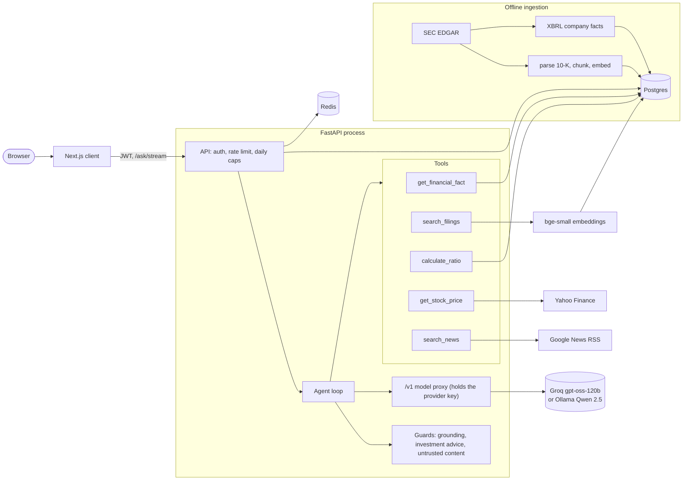
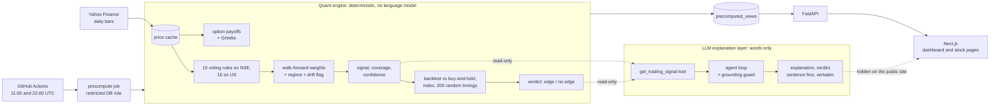

# Finance Research Copilot

An agent that answers questions about public companies from their SEC 10-K filings,
SEC's structured XBRL figures and live market data, and **will not state a number
that no tool returned**.

Ask "What was NVIDIA's diluted EPS in fiscal 2026?" or "At its August 7, 2026 close,
what P/E does that EPS imply?":
- It looks the figures up with tools.
- It cites the filing each one came from.
- It ends with a single figure a scorer can read.

If it cannot ground a number, it says so instead of guessing.

What is enforced today is **numerical provenance**: every figure in an answer
must match a value a tool returned in the same turn
([docs/KNOWN_LIMITATIONS.md](docs/KNOWN_LIMITATIONS.md)). Checking that each
figure is the right one for its claim (the right company, period, unit and
formula) is **claim-level verification, in progress**.

FastAPI and an agent loop in Python, Postgres with pgvector, Redis, a Next.js
client. The model is pluggable: Qwen 2.5 on a laptop through Ollama, or
`openai/gpt-oss-120b` hosted on Groq.

**Version 2** adds a [trading-signal research engine](#version-2-trading-signals):
- rule-based signals for five NSE stocks and three US stocks, each with a
  backtest against buy-and-hold and against random timing;
- a strategy card for every rule;
- option strategy payoffs with the Greeks.

The numbers come from deterministic code; the language model only explains them.
The headline result is negative and is reported as such: **no return edge**,
and no risk-adjusted edge either
([QUANT_HONESTY.md](benchmarks/QUANT_HONESTY.md)). So the signal is a
**strategy-audit tool**: it shows what textbook rules say about a stock, and how
they would have done, not where the price will go.

**Live:** https://finance-research-copilot-swart.vercel.app (version 1, deployed
2026-11-16 per [docs/DEPLOY.md](docs/DEPLOY.md); version 2 goes to the same address
per [docs/DEPLOY_V2.md](docs/DEPLOY_V2.md)). The free API sleeps after 15 minutes
idle, so the first request can take a while.

## Results so far

Every number below links to the file that records how it was measured: the command,
the commit, the date and machine, and the raw output. Anything not yet measured is
marked **pending**.

### Answer accuracy on the 40-question dev set

These are **dev-set** scores. The 40 questions were used during development,
so they overstate accuracy on questions the system has not seen. A
63-question held-out set is prepared (reviewed 2026-11-17) and has not been
run.

| system | dev set passed | source |
|---|---:|---|
| `gpt-oss-120b` on Groq, current code (`d106dae`, 2026-11-16) | **36/40** | [HOSTED_RUN_2026-11-16.md](benchmarks/HOSTED_RUN_2026-11-16.md) |
| `gpt-oss-120b` on Groq, before structured facts (2026-11-15) | 30/40 | [MODEL_COMPARISON.md](benchmarks/MODEL_COMPARISON.md) |
| `qwen2.5:7b` on a laptop CPU, baseline (2026-11-11) | 27/40 | [RUN_C_ANALYSIS.md](benchmarks/RUN_C_ANALYSIS.md) |
| `gpt-oss-120b`, with the arithmetic calculator | **pending**: scheduled for 2026-11-17 | |
| run-to-run noise of the hosted model | **pending**: one run per configuration so far | |

The hosted model's failures by root cause, between the two hosted runs
([HOSTED_RUN_2026-11-16.md](benchmarks/HOSTED_RUN_2026-11-16.md)):
- wrong tool: 3 to 0;
- grounding-guard refusals: 2 to 0;
- arithmetic: 2 to 1;
- retrieval misses: 3 to 3.

Every failure is classified by hand from its trace, by the rule in
[FAILURE_ANALYSIS.md](benchmarks/FAILURE_ANALYSIS.md).

### Latency and cost

| | measured | source |
|---|---|---|
| hosted, per question, wall clock | p50 26.3 s | [HOSTED_RUN_2026-11-16.md](benchmarks/HOSTED_RUN_2026-11-16.md) |
| hosted, without waits for the free tier's 8,000 tokens/min limit | p50 2.9 s, p95 8.0 s | same |
| hosted cost | $0.0016 per question (at Groq's published price, read 2026-11-15) | same |
| local `qwen2.5:7b` on CPU | p50 99.4 s | [MODEL_COMPARISON.md](benchmarks/MODEL_COMPARISON.md) |
| retrieval, `search_filings` over 45 filings | p50 66 ms, p95 88 ms | [STEP4_CORPUS.md](benchmarks/STEP4_CORPUS.md) |

### Scale and deployment

| | measured | source |
|---|---|---|
| corpus | 45 10-Ks of 15 companies, 2,914 chunks, 62,387 XBRL facts rows | [STEP4_CORPUS.md](benchmarks/STEP4_CORPUS.md) |
| ingestion from empty | 19.4 min on a laptop CPU; resumes after a crash and gives an identical index | same |
| retrieval hit@5 on a 29-question check, 2 filings against 45 | 100.0% against 75.9%: more years of each company confuse the year asked about | same |
| concurrent users, local model | 5 with no failures; the model is the ceiling between 5 and 10 (2026-09-13) | [LOAD_TEST_RESULTS.md](benchmarks/LOAD_TEST_RESULTS.md) |
| API memory under a 512 MB cap, answering a real question | 414.6 MiB peak, no out-of-memory kill | [CONTAINER_MEMORY.md](benchmarks/CONTAINER_MEMORY.md) |
| public demo on free tiers (Vercel, Render, Neon, Upstash) | deployed 2026-11-16 (version 1), with what was and was not checked live | [DEPLOY.md](docs/DEPLOY.md) |
| fix for the wrong-year retrieval | **pending** | [KNOWN_LIMITATIONS.md](docs/KNOWN_LIMITATIONS.md) |

## Architecture



| part | what it does |
|---|---|
| **Agent loop** (`agent/orchestrator.py`) | Up to five model rounds a question. Locally, a small router model picks tools and a larger one writes the answer; hosted, one model does both. |
| **Grounding guard** (`agent/grounding.py`) | Every number in a draft answer must appear in a tool result from that turn. One that does not is sent back to the model once, then shown under an `[Unverified]` caveat. It is never presented as fact. |
| **Advice and injection guards** (`agent/advice.py`, `agent/untrusted.py`) | No buy or sell recommendations. Filing text and news are fenced as data, so instructions embedded in them are not followed. |
| **Retrieval** (`rag/`) | pgvector with an HNSW index, metadata filters applied before the top-k, and a lexical and table-affinity re-rank. |
| **Structured facts** (`tools/facts.py`) | SEC XBRL figures by company, concept and fiscal year, each with the accession number of its filing as the citation. |
| **Model proxy** (`api/inference_proxy.py`) | One OpenAI-compatible endpoint in front of Ollama, Groq or Cerebras. The provider key never leaves the server. |
| **Eval** (`eval/`) | 40 questions with tolerances; a retrieval-only eval; a fast 15-question subset; a CI gate. |

## Version 2: trading signals

A research engine for daily signals on a watchlist:
- **NSE:** COFORGE, DIXON, SBIN, PREMIERENE and HDFCBANK, benchmarked on the Nifty 50.
- **US:** NVDA, AAPL and MSFT, benchmarked on SPY.

It is built to show what a signal is worth, not to recommend trades.

**What is in it.**
- **Signals.** 17 technical rules are defined in code (`market/strategies.py`); 15 of them vote
on an NSE stock and 16 on a US one (trend, breakout, mean
  reversion, momentum). One is a duplicate of Bollinger reversion and never
  votes; a long/short variant votes only where overnight shorts are allowed,
  that is on a US stock.
  - Weights are refitted walk-forward on the first trading day of each month,
    from each rule's trailing Sharpe ratio.
  - The market regime (ADX, the slope of the 50-day average, volatility
    percentile) halves the weight of rules whose style does not fit it.
  - BUY at a score of +0.25 or more, SELL at −0.25 or less.
  - Each signal states its coverage ("12 of 15 rules"), and its confidence is
    capped at that fraction.
  - Design: [docs/SIGNALS.md](docs/SIGNALS.md).
- **Backtests that can say "no".** Every signal is tested against:
  - buy-and-hold;
  - the index;
  - 200 random re-timings of its own positions.

  Indian delivery costs (STT, stamp duty, exchange and SEBI fees, GST, the
  depository charge) and slippage are included. "Edge" requires beating buy-and-hold on CAGR and Sharpe
  *and* beating 95% of the random re-timings.
  - Method: [docs/BACKTESTING.md](docs/BACKTESTING.md).
- **Strategy cards.** One page per rule and per option strategy: what it
  assumes, when it fails, and how it is computed.
  - [docs/strategies/](docs/strategies/).
- **Options.** Payoff grids for eight option strategies (long call, long put,
  bull call and bear put spreads, straddle, iron condor, covered call,
  protective put), with Black-Scholes delta, gamma, theta and vega.
- **Drift flag.** A CUSUM test marks a rule whose recent returns have fallen
  well below its own history.
  - It is shown on the page only. Acting on it (halving the rule's weight) is
    off until a pre-registered evaluation decides.
- **Precomputed pages.** A GitHub Actions job computes every stock page after
  the NSE close (11:00 UTC) and after the US close (22:00 UTC), and stores it.
  - A page is served stored only if it is newer than the latest session close
    and was made by the same signal code.
  - Otherwise the first visitor's request computes it.
  - The job connects as a database role that can read prices and write only
    the stored pages.

### Results (measured)

Five NSE stocks, 2021-11-16 to 2026-11-16, commit `eac9d0c`:
[benchmarks/SIGNALS_7C.md](benchmarks/SIGNALS_7C.md).

| | finding | source |
|---|---|---|
| **Return** | **No edge.** None of the five stocks reached the 95th percentile against random re-timing; the closest was DIXON at 0.89. CAGR was below buy-and-hold for COFORGE, SBIN and HDFCBANK. On SBIN the signal returned −5.3% a year while the stock compounded at 19.7%. | [SIGNALS_7C.md](benchmarks/SIGNALS_7C.md) |
| **Hold-out** | On ten NSE stocks never used to build anything, CAGR and daily Sharpe were below buy-and-hold on **10 of 10**. | same |
| **Drawdown** | Smaller than plain buy-and-hold on 11 of 15 NSE stocks. Against buy-and-hold held at the signal's own exposure, smaller on only **2 of 15**. The shallower drawdowns come from being out of the market about half the time, not from the timing, so they are not claimed as a benefit. | [QUANT_HONESTY.md](benchmarks/QUANT_HONESTY.md) |
| **Risk-adjusted, all 15 stocks** | The signal's Sharpe beat buy-and-hold's on 1 of 15 (median 0.44 against 0.65). Four simpler ensembles (equal-weight, majority, performance-weighted, best rule) did no better than the signal. Rules and thresholds written down before the run. | same |
| **Noise** | Moving the monthly refit day (1st to 20th trading day) alone moves a five-year CAGR by up to 11 points (DIXON: 17.4% to 28.1%). A difference between two single runs smaller than that is not a finding. On 13 of 15 stocks, no refit day beats buy-and-hold on both CAGR and Sharpe. DIXON beats it on 18 of 20 refit days, about what chance gives in 15 tries. | [SIGNALS_7C.md](benchmarks/SIGNALS_7C.md) |
| **A proposed fix, tested and rejected** | A faster regime-direction rule raised Sharpe on 3 of 10 hold-out stocks, with a median change of 0.000. The bar, written down before the run, was at least 6 of the 10 and a positive median, so it was not adopted. | [REGIME_RULE_CHECK.md](benchmarks/REGIME_RULE_CHECK.md) |
| **LLM explanations, local Qwen** | 3.3 to 6.4 minutes per stock on a laptop CPU; 1 in 5 timed out in each of the last two runs. Every finished explanation said "no edge", but in the last run three of the four also said something wrong that the guards cannot catch. Since then the engine's verdict sentence is placed first, verbatim (`96b329b`; not yet run live), and the "explain" button is hidden on the public site. | [SIGNALS_EXPLAIN_7C.md](benchmarks/SIGNALS_EXPLAIN_7C.md) |
| **Page load at Render's free-tier limits** (`--memory=512m --cpus=0.1`) | Computed on the visitor's request: dashboard 24.8–36.4 s. Stored: 0.29 s on the first request, then 0.04 s. A stock page with no stored copy: 24.3 s once, then 0.04 s. Peak memory 156 MiB. | [DEPLOY_V2.md](docs/DEPLOY_V2.md), section 6 |

**Not measured yet:**
- the US stocks' backtests (no committed record);
- whether the drift flag's down-weighting helps;
- version 2 on the live site.

The precompute timings above are from the five NSE pages, before the three US
stocks were added.

### Architecture: numbers from the engine, words from the model



The model never computes a signal, a weight or a backtest figure. It reads the
engine's output through one tool, and the grounding guard holds it to the
numbers in that output.

## How it was built

A few practices run through the repository:
- **One dated test count.** The full suite on master `e16826d`, 2026-11-18,
  with the whole local stack up: 1,622 passed, 12 xfailed, 0 skipped (1,634
  collected, 200 of them marked `safety`). Other documents point here rather
  than keep their own count.
- **Every measurement has a record.** A claim about accuracy, latency or memory
  comes from a command run on the code it describes. It is written up in
  `benchmarks/` with the commit, machine and raw output, and labelled measured,
  inferred or not run.
- **The goalposts do not move.** The eval questions, tolerances and the scorer
  are changed only with sign-off and never in the same commit as an agent change.
  The grounding guard's rules are protected the same way.
- **Corpora are pinned.** Filings by accession number, facts by date, so "the
  latest 10-K" cannot silently change what a result means.
- **Known limitations are written down, not hidden.**
  [docs/KNOWN_LIMITATIONS.md](docs/KNOWN_LIMITATIONS.md) lists what looks like
  a bug, why it is that way, and what would justify changing it.

## Running it

```bash
python -m venv .venv && .venv\Scripts\activate      # Windows; source .venv/bin/activate elsewhere
pip install -r requirements.txt
copy .env.example .env                               # set SEC_EDGAR_USER_AGENT; see the file

docker compose -f docker-compose.dev.yml up -d       # Postgres with pgvector, and Redis
python -m alembic upgrade head
python scripts/index_filings.py && python scripts/index_facts.py   # the eval's two filings
# or the 15-company corpus: python scripts/index_corpus.py

ollama pull qwen2.5:7b && ollama pull qwen2.5:1.5b   # or set AGENT_PROVIDER=groq in .env
uvicorn api.main:app --port 8000
cd frontend && npm install && npm run dev
```

```bash
python -m pytest -p no:cacheprovider -q -rs          # the test suite
python -m eval.run_eval --subset fast                # 15 questions against the running API
python -m eval.retrieval_eval                        # retrieval only, no model
```

## Documentation

- [docs/PROJECT.md](docs/PROJECT.md): the full design write-up
- [docs/DATABASE.md](docs/DATABASE.md): schema, auth, migrations
- [docs/STRUCTURED_FACTS.md](docs/STRUCTURED_FACTS.md): the XBRL facts tool
- [docs/INFERENCE.md](docs/INFERENCE.md): the model proxy and providers
- [docs/RATE_LIMITING.md](docs/RATE_LIMITING.md): the Redis sliding-window limiter
- [docs/DEPLOY.md](docs/DEPLOY.md): the public demo on free tiers
- [docs/DEPLOYMENT.md](docs/DEPLOYMENT.md): the full stack on one GPU host
- [docs/KNOWN_LIMITATIONS.md](docs/KNOWN_LIMITATIONS.md)
- [benchmarks/](benchmarks/): every measurement, with how it was taken
